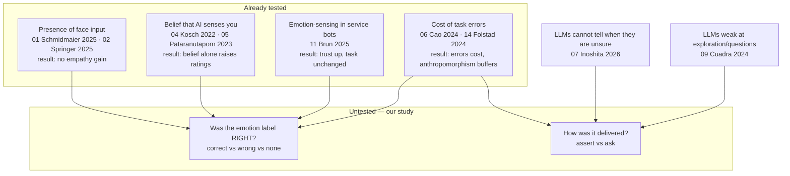
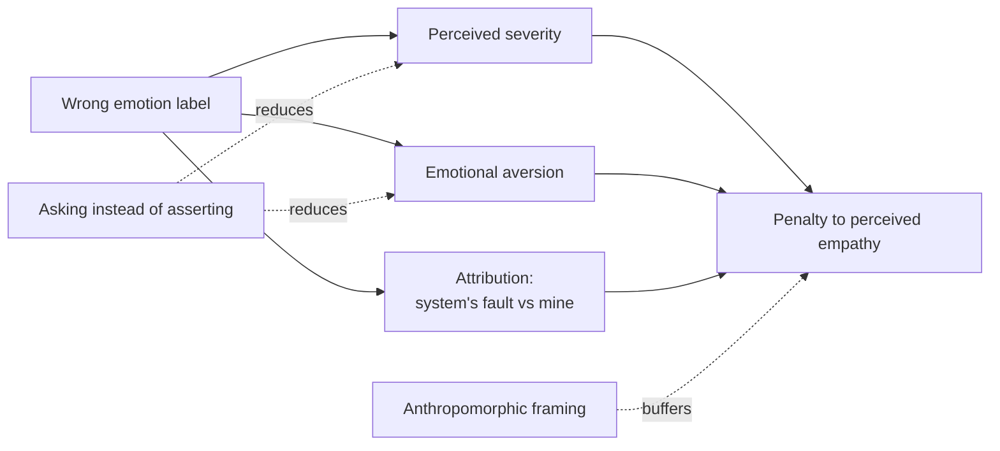
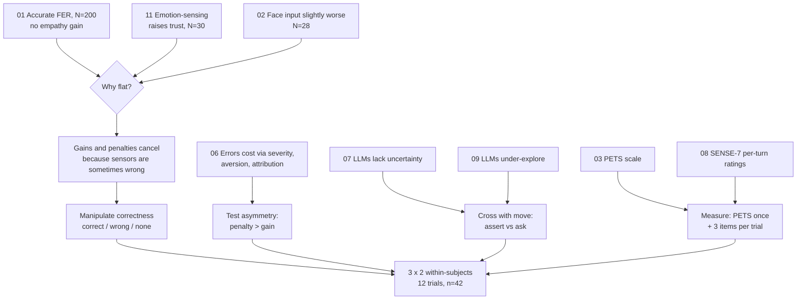

# Literature map — what each paper says, how it touches our study, what we should change

Companion to `LR/README.md` (files + DOIs). Our study: **label correctness × conversational move** — an LLM is told the emotion the participant just reported (`correct`), one of opposite valence (`wrong`), or nothing (`none`), and is instructed either to *assert* how they seem to feel or to *ask*. Protocol: `docs/STUDY_PROTOCOL.md`.

---

## Where the field is, and where we sit

---

## 1. Schmidmaier, Rupp, Harrich & Mayer (2025) — *Using Nonverbal Cues in Empathic Multi-Modal LLM-Driven Chatbots* (PACM HCI)

**What they did.** GPT-4 reads the user's face during a mental-health support chat. Between-subjects, N=200, four modes: **A** text only; **B** text + *placebo* FER (camera on, nothing processed); **C** text + real FER; **D** text + FER + proactive turn-taking. Measured with PETS on 101-point sliders.

**What they found.** FER worked — they validated GPT-4's facial-expression recognition separately. It changed the *language* of the replies (cognitive and affective dimensions, significant). Perceived empathy did not move: PETS medians 79.2 / 78.6 / 82.5 / 82.2, Kruskal-Wallis *H* = 1.72, *p* = .632.

**Relevance.** This is the paper we argue against, and it is stronger than the usual null: the sensor was accurate, so "the face reader was too weak" cannot explain the flat result. That leaves two live explanations — the effect is real but averaged away because sensors are sometimes wrong, or the effect does not exist. We test the first.

**What we should change because of it.**
- **Ceiling risk is real.** Their PETS medians sat at 79–82 out of 100 with IQRs reaching 89–90. On our 5-point items that compresses to "4 or 5" for most trials. Switch the global PETS to the validated 101-point sliders, and consider 0–100 sliders for the three per-trial items too.
- **Emotional intensity matters.** They report median emotional-experience ratings of only 52.8–62.0 and name low intensity as a possible reason for the null. Our two scripted elicitation trials (of twelve) may not be enough. Add a one-item intensity check per trial ("how strongly did you feel that?") as a covariate, and consider making the free-form prompt ask for something that actually mattered this week.
- **Keep the camera on in every condition.** They needed a separate placebo group because camera-on differed between arms. In our within-subjects design every trial captures the webcam, so the belief manipulation is constant and the placebo is controlled by construction — say this explicitly in the paper.
- **Cite their limitation as our motivation**, not as a weakness of theirs.

---

## 2. *Impact of Multimodal Emotional Input on User Experience in Chatbots* (2025, Springer LNCS) — **paywalled**

**What they did.** N=28; four chatbot conditions: text only, self-reported emotion, facial emotion, both.

**What they found.** Perceived empathy was *slightly higher without* facial input; participants low in trait emotional expressivity reported more positive affect when facial cues were included.

**Relevance.** The second null, and it hints at a moderator (expressivity). It also validates our use of a **self-reported** emotion condition as a distinct arm — they treated self-report as an input source, we use it as ground truth.

**Change.** Consider adding a short trait measure (emotional expressivity) at the end if IRB time allows; it is the only individual difference two papers now point at. Optional — do not let it delay submission.

---

## 3. Schmidmaier, Rupp, Cvetanova & Mayer (2024) — *PETS* (CHI)

**What they did.** Built and validated the Perceived Empathy of Technology Scale: 30 experts for item generation, 324 participants for item selection, 396 for validation, 22 scenarios with opposing empathy levels. Result: 10 items, 2 factors (Emotional Responsiveness, Understanding & Trust).

**Relevance.** Our measurement instrument, and the same group's scale as paper 01 — using it keeps our numbers directly comparable to the null we are extending.

**Change.** Administer PETS **as validated**: 101-point sliders, randomized item order. Our current 5-point radio implementation is a deviation that costs sensitivity and comparability for no benefit. Per-trial we keep the 3-item short form (a full PETS every turn would be 120 items per participant).

---

## 4. Kosch, Welsch, Chuang & Schmidt (2022) — *The Placebo Effect of AI in HCI* (TOCHI)

**What they did.** Participants told they had adaptive AI support performed better and expected more — with no actual adaptation.

**Relevance.** Any consent text that mentions a camera is itself a manipulation. Our design neutralises this by keeping camera capture identical across all six cells; the only thing that varies is what the generator is told afterwards.

**Change.** None to the design. Add one sentence to the paper's method: the placebo is held constant by design rather than measured in a separate arm.

---

## 5. Pataranutaporn, Liu, Finn et al. (2023) — *Priming beliefs about AI* (Nature Machine Intelligence) — **paywalled**

**What they did.** Told three groups the same mental-health chatbot was empathetic, neutral, or desensitised; ~30 min interaction.

**What they found.** The prime alone shifted perceived trustworthiness, empathy, and effectiveness.

**Relevance.** Sets the ceiling on what expectation can do, and warns that our consent wording ("some replies are deliberately based on an inaccurate guess") is itself a prime — it could depress ratings everywhere.

**Change.** Keep the disclosure (ethically required) but make it neutral in tone, and treat the funnel question as the check on whether participants formed a hypothesis about which turns were "fake". Report the funnel distribution in the results.

---

## 6. Cao, Li & Jiang (2024) — *When chatbots make errors* (Telematics and Informatics)

**What they did.** Online experiment, N=580, 2 (anthropomorphism: low/high) × 2 (chatbot type: task- vs relationship-oriented), between-subjects, on forgiveness of chatbot errors.

**What they found.** High anthropomorphism → more forgiveness, through an **affective route** (lower perceived severity, less emotional aversion) and a **cognitive route** (users attribute the error to themselves). Context-dependent.

**Relevance.** The closest published model of what an error costs, and the mechanism our H2 needs.

**Change.** Their mediators are exactly what "asking" should move. If we can afford one more per-trial item, make it severity-flavoured ("the reply got me wrong in a way that bothered me") — it converts H3 from a black-box effect into a mechanism claim. Also note: their design is *between*-subjects with 145 per cell; ours is within-subjects, which is why n=42 is defensible.

---

## 7. Inoshita, Zhou, Kawai & Yada (2026) — *LLMs Capture Emotion Labels, Not Emotion Uncertainty* (arXiv)

**What they did.** 640k LLM responses over GoEmotions and EmoBank; compared LLM outputs to human annotation *distributions*.

**What they found.** LLMs reproduce the majority label but not the disagreement; zero-shot models diverge from human distributions and only in-domain fine-tuning closes the gap. A "lexical-grounding gradient": explicit emotion words are easy, pragmatically inferred emotions are not.

**Relevance.** Two uses. It is the principled justification for the **ask** move — a system that cannot represent its own uncertainty should not assert. And it independently explains our MELD result, where the text branch collapses on Neutral (a pragmatic, non-lexical category).

**Change.** Cite it in the motivation for `ask` rather than presenting `ask` as a bare design intuition. Also cite it in the technical report next to the Neutral confusion row.

---

## 8. Suh, Le, Shayegani et al. (2025) — *SENSE-7* (arXiv)

**What they did.** 695 real conversations, 109 information workers, **per-turn empathy annotations by the users themselves**, plus user characteristics and context.

**What they found.** Empathy judgements are individual, context-sensitive, and break when conversational continuity fails or expectations go unmet. An LLM classifier reached only ρ = 0.369 predicting them.

**Relevance.** Precedent that per-turn, self-annotated empathy is a legitimate DV — that is our primary measure. "Expectation violation" is also the mechanism we expect behind the wrong-label penalty.

**Change.** None. Cite as precedent for the per-trial design and in the discussion of individual variation.

---

## 9. Cuadra, Wang, Stein et al. (2024) — *The Illusion of Empathy?* (CHI)

**What they did.** Prompted conversational agents to display empathy across 65 human identities.

**What they found.** High marks for emotional *reaction*; low for *interpretation* and *exploration* — the model reacts but does not probe.

**Relevance.** Direct support for studying the assert/ask contrast: current systems over-assert and under-explore, so "ask" is the under-used move, not an arbitrary alternative.

**Change.** Use it to frame H3 in the introduction.

---

## 10. Liu, Giorgi, Aich et al. (2024) — *The Illusion of Empathy: How AI Chatbots Shape Conversation Perception* (arXiv)

**What they did.** 155 conversations comparing GPT-based chatbots with human partners.

**What they found.** Chatbots scored *higher* on conversational quality but *lower* on empathy; GPT-4o judges agreed with users.

**Relevance.** Fluency and perceived empathy dissociate. That is the justification for holding the generator fixed and varying only what it is told — otherwise any effect could be a fluency artefact.

**Change.** None; cite in the method rationale.

---

## 11. Brun, Liu, Shukla, Watson & Gratch (2025) — *Exploring Emotion-Sensitive LLM-Based Conversational AI* (arXiv)

**What they did.** N=30, emotion-sensitive vs emotion-insensitive customer-service chatbot.

**What they found.** Emotion-sensitive raised perceived trustworthiness and competence; issue-resolution rates unchanged.

**Relevance.** A *positive* presence-of-sensing result, against papers 01 and 02. The contradiction is the point: presence of sensing gives mixed results across studies, which is what you expect if the real variable is whether the sensing was right.

**Change.** Put 01, 02, 11 side by side in related work as the motivating inconsistency.

---

## 12. Barrett, Adolphs, Marsella, Martinez & Pollak (2019) — *Emotional Expressions Reconsidered* — **paywalled**

**What they say.** Facial configurations map to emotion categories far less reliably than the basic-emotion view assumes; context dominates.

**Relevance.** Ethical and scientific caveat. It is also the reason our design does not depend on the face sensor being right: correctness is assigned from self-report, and the sensor is logged only for exploratory analysis.

**Change.** Already in the debrief text and limitations. Keep.

---

## 13. Wobbrock, Findlater, Gergle & Higgins (2011) — *Aligned Rank Transform* (CHI)

**Relevance.** Our design is a 3 × 2 factorial on ordinal data. Our pre-registered analysis uses Friedman plus Holm-corrected Wilcoxon on named contrasts, which is defensible and simpler. ART would let us report a proper interaction test (label × move).

**Change.** Add ART as a *secondary, pre-registered* analysis for the interaction term. Reviewers who want a factorial test will look for it; without it we can only speak about contrasts.

---

## 14. Følstad, Law & van As (2024) — *Conversational Breakdown in a Customer Service Chatbot* (TOCHI) — **paywalled**

**What they say.** Error cost on trust and emotion depends on when the error happens and how critical the task is.

**Relevance.** Order effects for errors. Our Williams square balances position, so a "wrong" trial is equally likely early or late — worth stating, since this paper shows position matters.

**Change.** Report position as a covariate in the exploratory analysis.

---

## 15. Tahir, Johnson, Abu-Khalaf & Shah (2025) — *E-THER* (arXiv)

**What they did.** 5 h of person-centred therapy, 18 sessions, 1,578 turns, 789 annotated dialogue pairs labelled for verbal–visual incongruence (minimising / contradiction / none) plus VAD.

**Relevance.** The only dataset that annotates exactly the masking phenomenon our scripted trials elicit. Not needed for the LBW; it is the natural external validation for our valence-dissonance flag in a follow-up.

**Change.** Email s.tahir@ecu.edu.au about access now — lead time is weeks, and the ACII version of this work would be stronger with it.

---

## 16. Welivita & Pu (2024) — *Are LLMs More Empathetic than Humans?* (arXiv)

**Relevance.** Baseline for how empathic LLM text alone is rated. Our `none` condition is exactly this setting, so their numbers tell us roughly where our control arm should land.

**Change.** None; cite when reporting the `none` condition mean.

---

## 17. Poria, Hazarika, Majumder et al. (2019) — *MELD* (ACL)

**Relevance.** The benchmark behind our Section 5 numbers (text branch 43.0 %, below the 48.1 % majority floor; fusion hurts). Those numbers are why the paper stops claiming recognition performance.

**Change.** None.

---

## 18. Concannon & Tomalin (2023) — *Measuring perceived empathy in dialogue systems* (AI & Society) — **paywalled**

**What they say.** Most perceived-empathy measures for dialogue systems are ad-hoc and unvalidated.

**Relevance.** Justifies PETS for the global measure and forces us to defend the three per-trial items.

**Change.** In the paper, present the per-trial items as a *short proxy* validated post-hoc against the participant's own PETS score (correlate the trial composite mean with PETS-total per participant). That is a cheap, honest validity check we can run at analysis time.

---

## How the pieces drive our design

---

## Concrete changes to make before the pilot

| # | Change | Driven by | Effort |
|---|---|---|---|
| 1 | PETS on 101-point sliders, randomized item order (as validated) | 03, 01 | 1 h |
| 2 | Consider 0–100 sliders for the 3 per-trial items; ceiling risk is documented (their PETS medians ≈ 80/100) | 01 | 1 h |
| 3 | Add a per-trial emotional-intensity item as covariate | 01 (their stated limitation) | 30 min |
| 4 | Add a severity-flavoured item to expose the H3 mechanism | 06 | 30 min |
| 5 | Pre-register ART as a secondary test for the label × move interaction | 13 | 30 min |
| 6 | State in the method that the placebo is constant (camera in every trial) | 04, 01 | 5 min |
| 7 | Report trial position as an exploratory covariate | 14 | free |
| 8 | Validate the 3-item proxy against per-participant PETS at analysis time | 18 | free |
| 9 | Email for E-THER access (for the follow-up, not the LBW) | 15 | 10 min |

Items 1–5 change the instrument, so they must land **before** OSF registration and the pilot. Items 6–8 are analysis or wording. Item 9 is future work.
