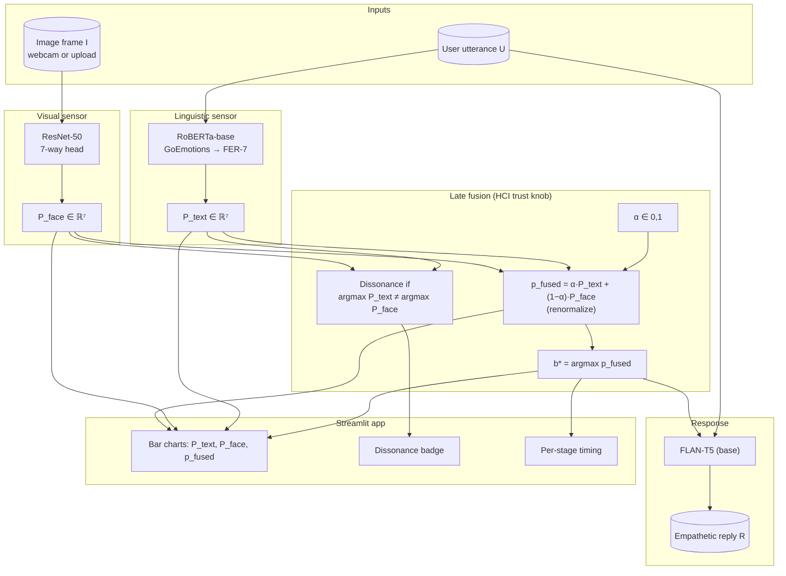
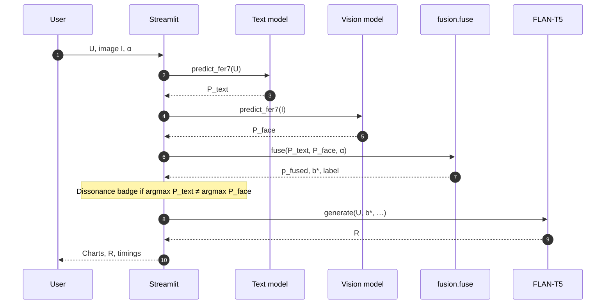
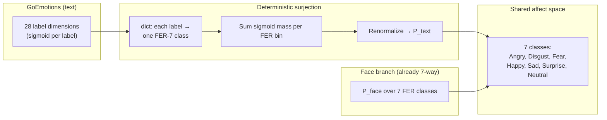
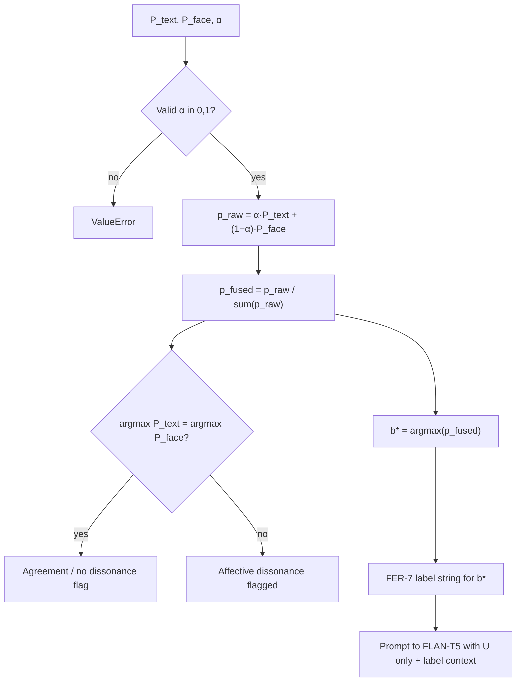
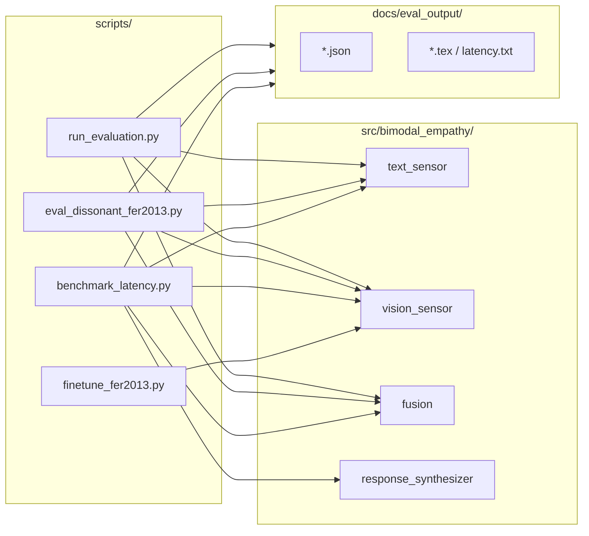
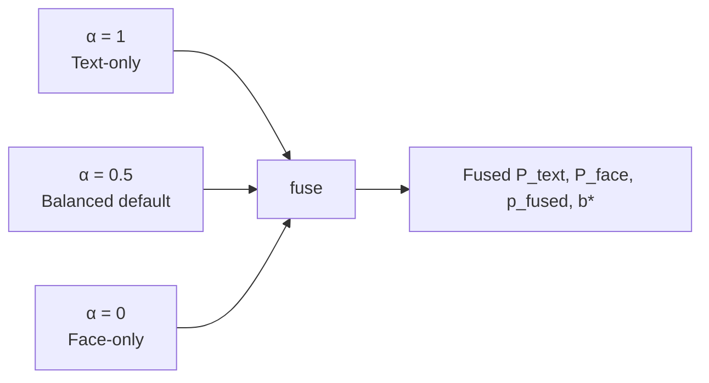

# Bimodal Affective Alignment — Visual Overview

This page complements [`README.md`](README.md) with **Mermaid** diagrams: system architecture, end-to-end request flow, label alignment, and fusion / dissonance logic. Mermaid renders on GitHub, many IDEs, and tools such as the [Mermaid Live Editor](https://mermaid.live).

---

## 1. System architecture (components)

High-level view of the runtime stack: two sensors, a fusion gate, a generator, and the demo shell.

**Checkpoint note:** the vision branch can load the public **AffectNet**-style weights (`ElenaRyumina/face_emotion_recognition`) or a **FER2013 fine-tuned** checkpoint from `checkpoints/`; fusion and the rest of the code path are unchanged (swap weights only).

---

## 2. End-to-end data flow (one analysis)

Single user action: *Analyze & generate* — order of operations matches the main app pipeline.

---

## 3. Label-space alignment (28 GoEmotions → 7 FER-7)

Text side maps fine-grained multi-label GoEmotions output into the same **seven** classes as the face model so fusion is defined.

---

## 4. Fusion and dissonance (logic)

Implements `bimodal_empathy.fusion.fuse` and the dissonance rule used in the UI.

The synthesizer is intentionally **not** given raw `P_text` / `P_face` vectors—only the utterance and fused class (and optional single-line descriptor derived from the fused label), per project design.

---

## 5. Evaluation scripts (reproducibility)

How benchmark artifacts relate to the same core library (not a separate “eval stack”).

---

## 6. Optional: ablation / operating points

The three rubric ablations are the same fusion with **α = 1**, **0.5**, and **0**.

---

*Diagrams are descriptive; for exact APIs and CLI flags, see [`README.md`](README.md) and the modules under `src/bimodal_empathy/`.*

---

## Glossary — acronyms and full forms

| Abbrev. | Full form / meaning (this project) |
|--------|--------------------------------------|
| **α (alpha)** | **Trust weight** in \([0,1]\) for late fusion: weight on the **text** distribution vs \((1-\alpha)\) on the **face** distribution. |
| **API** | **Application Programming Interface** — e.g. Hugging Face model hub APIs. |
| **AffectNet** | Large-scale **facial affect** dataset (color, near-frontal faces); the shipped ResNet checkpoint is trained in that *style* before FER2013 fine-tuning. |
| **BERT** | **Bidirectional Encoder Representations from Transformers** (Google). *This project’s text path uses* **RoBERTa** (a different transformer), not BERT. |
| **b\*** (b-star) | **Fused affect class** — \(\arg\max_k\) of the blended 7-way distribution (discrete FER-7 label). |
| **CNN** | **Convolutional Neural Network** — e.g. ResNet backbone for images. |
| **CV** | **Computer Vision** (face / image branch). |
| **Doherty threshold** | Rule of thumb from HCI: **&lt; ~400 ms** for interactive responsiveness; we compare **affect** timing (~tens of ms) vs **full** reply latency (dominated by text generation). |
| **E2E** | **End-to-end** (e.g. utterance + image → reply, full pipeline). |
| **FER** / **FER-7** | **Facial Expression Recognition** — here, **7 classes** aligned to FER2013’s taxonomy: Angry, Disgust, Fear, Happy, Sad, Surprise, Neutral. |
| **FER2013** | **Facial Expression Recognition 2013** — benchmark dataset of **48×48** grayscale face images, 7 expression labels. |
| **FLAN** | **F**inetuned **La**nguage **N**et (Google) — instruction-following seq2seq family used as the backbone for our generator. |
| **FLAN-T5** | **FLAN** + **T5** (see T5) — we use the **base** size (~**220M** parameters). |
| **GoEmotions** | Reddit-based dataset with **28** fine-grained emotion taxa (per-label sigmoid), mapped here to 7 FER classes. |
| **HCI** | **Human–Computer Interaction** — e.g. trust knob, Doherty, perceived latency, dissonance as user-visible state. |
| **HF** / **Hugging Face** | Hub for models and datasets; project loads checkpoints and data via `transformers` / `datasets`. |
| **Likert** (HCI) | A **5-point** ordered rating scale. In the Streamlit app, three items (Empathy, Social presence, Affective congruency) can be **saved to CSV** via `data/likert_responses.csv` (or the **`LIKERT_CSV`** environment variable). |
| **I** | **Image frame** (webcam or upload) input to the vision model. |
| **LM** | **Language model** — here, FLAN-T5 as **conditional** generator of reply **R** given **U** and **b\***. |
| **MPS** | **Metal Performance Shaders** — Apple’s GPU API; latency in the report is often measured on **Apple MPS** devices. |
| **NLP** | **Natural Language Processing** (text / utterance branch). |
| **P\_face** | **Probability vector** over 7 FER classes from the **face** model (length 7, normalized). |
| **P\_text** | **Probability vector** over 7 FER classes after **GoEmotions → 7** mapping (length 7, normalized). |
| **R** | **Response** (generated empathetic text from FLAN-T5). |
| **ResNet-50** | **Residual Network** with **50** layers — CNN backbone for face emotion, 7-way head. |
| **RGB** | **Red, Green, Blue** color channels; inputs are often resized to **224×224** for the face path. |
| **RoBERTa** | **R**obustly **o**ptimized **BERT** **a**pproach — transformer encoder; checkpoint `SamLowe/roberta-base-go_emotions`. |
| **RNN** | **Recurrent Neural Network** — *not* the main architecture here; transformers + CNN are used. |
| **T5** | **Text-to-Text Transfer Transformer** (Google) — seq2seq; FLAN-T5 is an instruction-tuned variant. |
| **U** | **Utterance** — user’s text in natural language. |
| **Rubric “FER-7 / FER2013”** | Course spec uses FER2013’s **7-class** setup; all fusion is done in that shared space. |

---

## Q&A — questions you may be asked (with short answers)

**1. What problem does bimodal alignment solve?**  
Text alone can miss sarcasm, politeness, or neutral wording that hides stress; a face image alone is noisy (lighting, angle, domain shift). **Fusing** both gives a more stable 7-class affect decision and lets you **flag** when the two channels disagree (affective dissonance) instead of silently picking one.

**2. What does “late fusion” mean here?**  
Each modality is classified **independently** to **P_text** and **P_face** first; only then do we **blend** them with **α** and take an argmax. We do *not* train one joint neural net over raw pixels + text tokens in this project.

**3. Why is α called a “trust” weight?**  
Larger **α** puts more weight on the **text** vector; smaller **α** trusts the **face** more. The Streamlit app exposes **α** so a user or reviewer can **interpret** the trade-off (HCI) rather than hiding it as a black-box hyperparameter.

**4. How did you pick α = 0.5 as default?**  
It is a **balanced** blend. On the **matched** bimodal benchmark, fused acc is close to text-only; on **dissonant** cases with a **synthetic** perfect face, α = 0.5 recovers the intended class when the text is wrong by design. Tuning a dense grid of α (e.g. 0.2–0.8) is *optional* and documented as **sensitivity** in the report rather than the main story.

**5. What exactly is “affective dissonance” in the app?**  
We flag dissonance when **argmax(P_text) ≠ argmax(P_face)** — a simple, inspectable rule. The UI shows a **badge** so the disagreement is **visible** before the user reads the generated reply.

**6. Why map GoEmotions (28) down to 7 FER classes?**  
The face model only outputs **7** classes. Fusion needs **one shared discrete space**; we use a **fixed dictionary** mapping every GoEmotions label to exactly one FER-7 class, and aggregate **sigmoid** mass per bin for multi-label text output.

**7. Why are fused numbers low (~4.3%) on *real* dissonant images?**  
By construction, **text** is **wrong** on purpose; recovery requires the **face** branch to be **strong and correct** often enough. With the **baseline** face (high domain error on FER2013, ~23% top-1), the fused model still tracks **wrong text** most of the time. After **FER2013 fine-tuning** (~68.5% face top-1), fused dissonant accuracy **rises a lot** (e.g. **~42%** in the report) because the face can **override** bad text in more cases.

**8. What does the synthetic 100% row in dissonance show?**  
It replaces the face output with a **one-hot** vector for the **true** class so the face side is “perfect.” Then α = 0.5 recovers the gold label even when the text is misleading — a **sanity check** that **fusion math** is implemented correctly; the limit in deployment is the **noisy** face, not the formula.

**9. Do you pass the probability bars into FLAN-T5?**  
**No** — by design, the generator conditions on **U** and the **discrete fused label (and a short natural-language descriptor)**, not on full P_text / P_fused vectors. That keeps the reply stage **interpretable** and avoids leaking numeric distributions into a small seq2seq model.

**10. Is “empathy” here measured with user studies?**  
You can collect **5-point Likert** rows in the **Streamlit** UI (Empathy, Social presence, Congruency) and append them to a **CSV** (`data/likert_responses.csv` or `LIKERT_CSV`). For the paper, the app's **Participant (study)** mode runs a within-subjects **PETS** study (3 conditions × 3 blocks, blind, `data/study_responses.csv`); the design, hypotheses and analysis plan are in `docs/STUDY_PROTOCOL.md`. The 3-item quick Likert remains available in Researcher mode.

**11. Is the system real-time?**  
**Affect** inference (text + face + fusion) is **fast** (order of **tens of ms** on MPS in the report’s table). **End-to-end** including **FLAN-T5** beam search is **hundreds of ms to ~1 s** depending on hardware; the report notes **token streaming** as a product mitigation so **perceived** latency is lower than **full** generation time.

**12. What is the Doherty threshold?**  
Often cited as **&lt; ~400 ms** for interactive feedback to feel “immediate.” We compare the **affect** subtotal to that bar; full **generation** often exceeds it unless you stream or use a smaller/faster model.

**13. What are the top limitations?**  
Templates vs spontaneous speech, **face** domain and label noise, **small** generative model (FLAN-T5 **base**), and **no** large formal user study. See the report **Limitations** subsection.

**14. Is this fair / could it be used for surveillance?**  
A course demo should **not** be deployed for monitoring without ethics review, consent, and **bias** analysis across demographics. The system is a **probe** of alignment, not a certified assistive or clinical tool.

**15. How do I reproduce a number from the report?**  
Run the **scripts** listed in `README.md` (e.g. `run_evaluation.py`, `eval_dissonant_fer2013.py`, `benchmark_latency.py`, `finetune_fer2013.py`); outputs land under `docs/eval_output/` and feed the LaTeX report.

**16. “Why RoBERTa and not BERT?”**  
The handout / course text says BERT *or* RoBERTa; we use a **public** **RoBERTa** checkpoint fine-tuned on **GoEmotions** so we do not retrain the text head from scratch.

**17. What if both modalities are wrong?**  
Fusion can still pick a wrong **b\***. The dissonance **badge** only detects **disagreement** between modalities, not **ground truth** (which is unknown at runtime in a real chat). That is a fundamental limit without external labels or a human in the loop.

For setup and commands, use [`README.md`](README.md).
